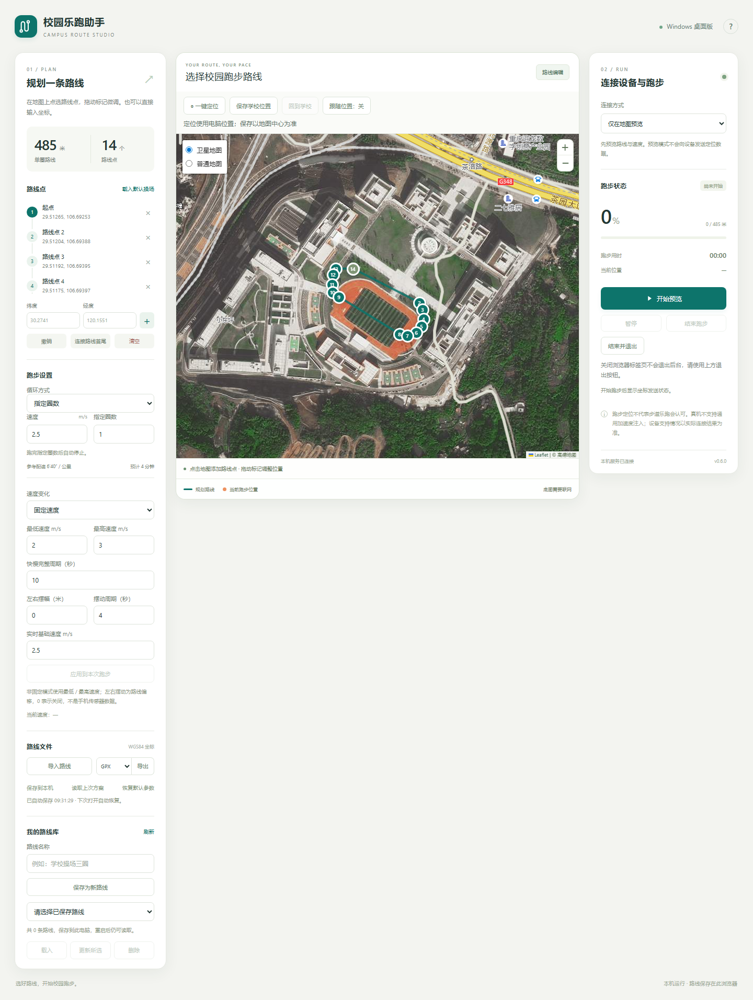
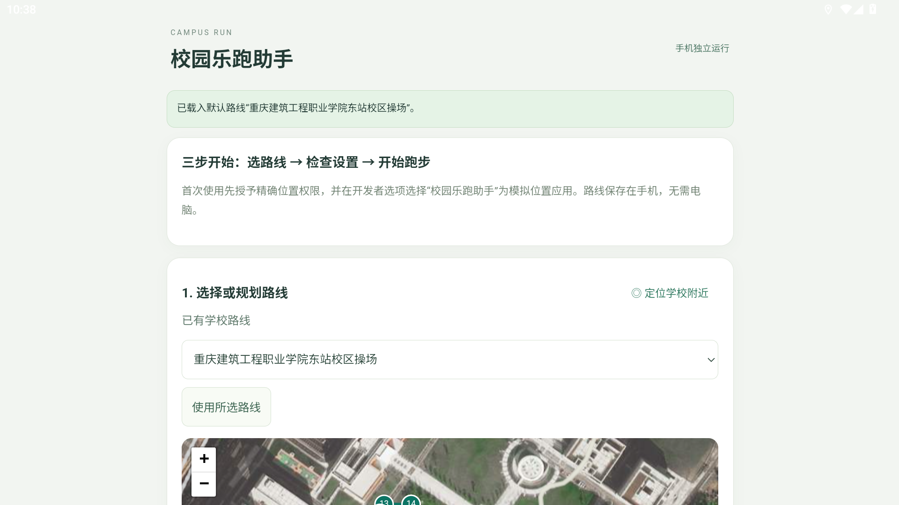

# 校园乐跑助手

> 当前测试版：Windows 0.6.4 安卓免安装 APK 直连，手机独立版 0.6.3。Windows 已通过 Android 15 模拟器运行验收；安卓实体手机与 iOS 尚未验收。见 [运行验收报告](DIRECT_RUNTIME_VALIDATION.md)。
> Windows 安卓模式已移除手机 APK 依赖，使用 ADB 临时进程；运行时仍有临时文件与进程。详见 [WINDOWS_DIRECT.md](WINDOWS_DIRECT.md)。
> 手机 0.6.3 移除小窗，增加电池优化豁免申请和系统回收后的近期进度恢复；见 [BACKGROUND_OPERATION.md](BACKGROUND_OPERATION.md)。无法保证厂商不结束后台或所有目标软件都持续接收。
> 0.6.0 的历史测试结果不代表此版本或所有厂商手机已通过。见 [COMPATIBILITY_VALIDATION.md](COMPATIBILITY_VALIDATION.md)。

在高德地图上选择校园跑步路线，设置距离、配速和圈数，再开始跑步定位。
提供 Windows 安装版和 Android 版。地图默认使用**高德卫星影像 + 高德道路标注**，
可切换为高德普通地图；卫星瓦片不可用时自动回退。

**[下载当前测试版](https://github.com/Chanray-May9/campus-route-studio/releases/tag/v0.6.4)** ·
[下载页](https://chanray-may9.github.io/campus-route-studio/)

## Windows：安装后直接使用

1. 下载 `CampusRouteStudio-Windows-Setup-0.6.4-direct-test.exe`，按中文向导安装。
2. 打开桌面或开始菜单里的“校园乐跑助手”，浏览器自动打开本机界面。
3. 选择校园路线，设置速度和圈数。先使用“仅在地图预览”检查路线。
4. 通过 USB 连接手机，在界面选择对应设备并完成首次连接设置。
   点击“开始跑步”，在乐跑里确认位置持续变化后再开始记录。
5. 结束时点击“结束并退出”。关闭浏览器标签页不会退出本机程序。

安装包内置 Python、ADB、安卓临时直连组件和 iOS 连接依赖，**不需要安装 Python、
JDK 或 Android SDK，也不需要配置 PATH**。支持 Windows 10/11 x64，按当前用户安装，
不要求管理员权限。系统“已安装的应用”中可以卸载；保存的路线留在当前用户的本地数据目录。

也提供免安装 `CampusRouteStudio-Windows-0.6.4-direct-test.zip`，解压后打开 `CampusRouteStudio.exe`。
此 ZIP 同样包含运行环境。源代码请下载 `CampusRoute-Source-0.6.4.zip`。



## Android：手机独立使用

安卓版面向真实 Android 8+ 手机，路线计算和 GPS/network 定位发送都在手机内完成，
**无需电脑，不需要 Root**。首次使用授予精确位置权限、打开系统定位，
在开发者选项的“选择模拟位置信息应用”中选择“校园乐跑助手”。
切换到其他 App 后由前台定位服务持续运行；若厂商限制后台运行，在应用设置中解除电池限制。

本次调整了后台工作线程、启动确认、时间戳、前台服务和有超时保护的唤醒锁，保留系统原生融合定位，
并展示系统实际回调和移动距离。详细设置见 [MOBILE_SETUP.md](MOBILE_SETUP.md)。

历史 0.6.0 修复了 GPS 数据缺少传统卫星数量元数据导致目标应用不采用后续坐标的问题。
使用**手机 APK 自身的 GPS/network 定位链路**进行测试，
步道乐跑 4.2.6 自由跑里程持续增加，暂停、继续和熄屏运行通过；正式 APK 也单独验证通过。
安卓版在手机内计算路线并持续发送坐标，没有电脑定位桥依赖。
真实手机尚未实测，不能把单一设备验证当成所有手机或所有目标应用都兼容。
历史数据见 [VALIDATION.md](VALIDATION.md)。手机独立版 0.6.3 的后台恢复尚未完成设备验收，详见 [BACKGROUND_OPERATION.md](BACKGROUND_OPERATION.md)。



## Windows 连接其他设备

- Android USB：开启 USB 调试、确认电脑授权，使用电脑的“检测安卓直连”；不安装手机 APK。
  开始时验证系统定位权限与通道，运行中使用 ADB 临时定位进程。系统限制与实际目标软件接收需在设备上核对。
- iPhone USB：需要 Apple 设备驱动、解锁并信任电脑，以及系统要求的开发者模式和服务。
  安装包已内置 Python 连接库，但 Apple 驱动和手机系统设置仍需完成。此次未测试真实 iPhone。
- Android 官方模拟器：支持模拟器定位，提供可选运动传感器模拟。

## 坐标与偏移

路线、导入导出文件和内部计算统一使用 **WGS84**；高德普通地图和卫星地图均按
**GCJ-02** 显示。地图点击时转回 WGS84，显示时转成 GCJ-02，路线数据不会反复偏移。

手机定位直接使用 WGS84；地图优先显示近期系统实际反馈的坐标。
坐标转换、实际输出误差与测试范围见 [验证说明](VALIDATION.md)。
底图影像本身的测绘精度不等于定位数值精度，请核对实际场地边界。

## 路线功能

- 地图点选、拖动调整、连接首尾、坐标输入；切换底图保留路线。
- 导入 GPX、GeoJSON、JSON；路线库、备份导出。
- 内置重庆建筑工程职业学院东站校区操场路线；请自行核对实际跑道边界。
- 固定速度、平缓变速、交替变速、左右偏移、指定圈数或持续跑步。
- 安卓推荐设置默认目标 3.2 公里、6 分钟/公里，自动计算完整圈数。
- 运行中调整速度、暂停、继续、结束；后台定位发送与实际系统反馈分别展示。

学校的场地、打卡点、距离、配速、有效时段和记录次数要求以学校及乐跑实际规定为准。
应用内展示的是规则参考，工具不读取随机打卡点或学生成绩判定。

## 开发与构建

使用 Python 3.12 x64、Node.js、JDK 17+、Android SDK 35+。开发环境与终端用户安装无关。

```powershell
python -m unittest discover -s tests -v
node --test tests/test_run_rules.cjs
node tests/test_coordinates.cjs
node tests/test_basemap.cjs
node tests/test_mobile_ui.cjs  # 需要 Playwright
python scripts/build_android.py --source-dir mobile --apk-name CampusRoute-Mobile.apk
python scripts/build_android.py
python scripts/build_android_bridge.py
python -m pip install pyinstaller==6.20.0 -r requirements-ios.txt
python scripts/build_windows.py --iscc "C:/Program Files (x86)/Inno Setup 6/ISCC.exe"
python scripts/package_release.py --output dist/release --android-build build --windows-build dist
```

定位测试（必须指定专用测试设备；系统定位测试不能证明乐跑兼容性）：

```powershell
python scripts/test_android_replay.py --serial DEVICE_SERIAL
python scripts/test_android_replay.py --build-only
```

安卓覆盖更新须使用相同签名，构建时保留原有 `build/android-helper-debug.keystore`。
新电脑生成的开发密钥与既有 APK 不同，会导致系统拒绝覆盖安装；请先备份本地路线。
密钥不得上传或分发。公共路线服务说明见 [cloudflare/README.md](cloudflare/README.md)。

许可证：[GPL-3.0-or-later](LICENSE)；第三方许可：[THIRD_PARTY_NOTICES.md](THIRD_PARTY_NOTICES.md)。
